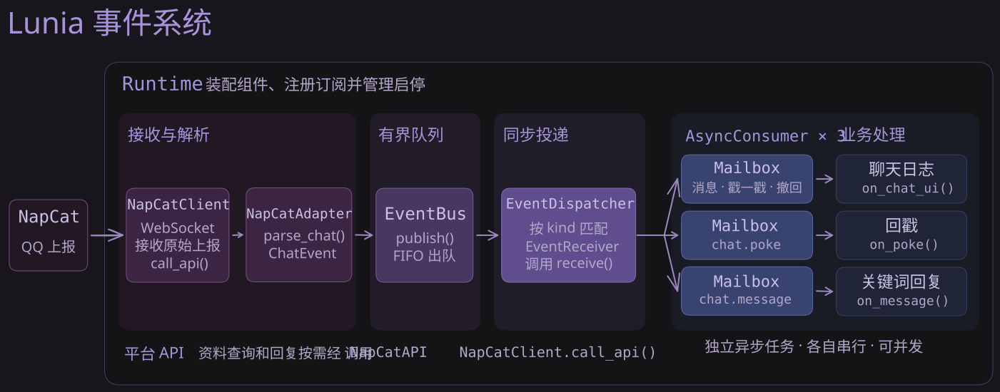

# Lunia


Lunia 是一个正在开发中的开源 AI 虚拟角色框架。

这是一个能够持续存在于数字环境中的角色。她可以参与日常聊天，关注身边发生的事情，也可以和大家一起玩游戏。

她不必等待别人发出明确的指令才开始行动。面对不同的事件，她可以自行决定是否回应、如何回应，以及接下来想做什么。

为此，Lunia 围绕实时事件流、行动路由、大语言模型调用与角色状态管理展开设计，并尝试将决策模型与大语言模型结合，让角色拥有更自然的互动节奏。

当前处于早期开发阶段，已实现基于 QQ / NapCat 的入站事件流、按 Adapter 实例路由的出站消息发送、基于 OpenAI 兼容协议的最小 `LLMManager`，以及一个正在演进中的单轮 LLM 对话演示（`ChatDemo`）。完整的 `Actor`、记忆上下文、决策系统与唯一在场状态机尚未实现。

## 定位与长期目标

Lunia 面向持续的角色陪伴，希望逐步形成稳定的人格、上下文和可积累的经历。长期设计遵循以下方向：

- 核心能力独立于 AstrBot、具体模型和游戏，外部平台与游戏作为可替换的集成。
- 只有一个主要在场状态或活动，避免同时参与互斥场景。
- 优先复用成熟组件，保持模块职责清晰，避免提前构建复杂框架。
- 逐步支持聊天、游戏及更多交互方式，保持角色与状态的连续性。

## 已实现的功能

- **NapCat Adapter 与分类 API**：`NapCatAdapter` 封装 `NapCatClient` 生命周期（`start` / `run` / `stop`）、`NapCatAPI` 与 `NapCatMessageProvider`；支持 WebSocket Bearer 鉴权、断线重连、`echo` 请求响应关联、超时与断线清理，提供 6 个分类共 108 个 API 方法。
- **统一聊天事件与信封**：将 QQ 私聊、群聊消息、戳一戳和撤回通知转换为 `ChatEvent`，由 Adapter 包装为携带 `adapter_id` 的 `EventEnvelope`；支持文本、提及、引用、图片、语音、视频、合并转发、JSON 卡片及未知消息段的结构保留。
- **进程内事件流**：`EventBus` 使用有界队列按入队顺序投递（队列满时计数拒收并返回 `False`，停止时带超时排空）；`EventDispatcher` 按事件类型同步调用订阅者并隔离异常；`AsyncConsumer` 各自维护有界队列并串行执行异步处理器。
- **最小行动路由**：`ActionRouter` 按 `adapter_id` 注册并路由 `SendMessage` 行动至对应的 `MessageProvider`（当前已接入 `NapCatMessageProvider`）。
- **最小 LLM 调用层**：`LLMManager` 管理模型别名与 Provider 客户端，通过 `OpenAICompatibleClient`（基于 `openai` SDK 的 `AsyncOpenAI`）完成单轮文本补全。
- **显示名称辅助与日志**：用户与会话名称进程内缓存，按需调用 Resolver 补全名称并通过 `NapCatUserProvider` 查询用户资料；提供终端可读文本格式化、控制台彩色日志及 `logs/lunia.log` 文件日志。
- **Runtime 与对话演示**：`core/runtime.py` 装配上述组件，消费事件输出聊天日志；通过 `ChatDemo` 对群聊中包含 `lunia`（不区分大小写）的文本及指定测试账号（`TEST_QQ`）的私聊文本发起单轮 LLM 回复并经 `ActionRouter` 发送；被其他用户戳一戳时直接经 NapCat API 回戳。
- **手动联调工具**：连接/API、事件接收、聊天文本显示和交互式 API 控制台脚本。

## 规划功能（尚未实现）

- `Actor` 统一行为调度中心、决策模型与完整的 LLM Harness（多轮上下文、Run、工具循环与中断控制）。
- 通用 `Adapter` 契约与 `Adapter Registry`，以及按会话等顺序域划分的事件队列与扩展背压策略（待按需设计）。
- 稳定人格、动态上下文、持久化长期记忆和持续状态。
- 唯一在场状态机与互斥活动管理。
- 「谁是卧底」、UNO 及多人游戏界面与专用交互接口。
- 其他聊天平台、语音与视觉能力，以及 VPS 长期运行的部署方案。

## 环境要求与快速开始

使用 Python **3.13**（`>=3.13,<3.14`）和 `uv` 管理环境。运行依赖为 `websockets` 和 `openai`，开发依赖包含 Ruff 和 pytest，具体约束见 [pyproject.toml](pyproject.toml)。QQ 联调还需要已登录且启用 WebSocket 服务的 NapCat。

在项目根目录的 PowerShell 中执行：

```powershell
uv sync --locked
uv run python --version
uv run lunia
```

`uv run lunia` 目前仅输出“Lunia工程已初始化。”并退出，不启动聊天连接。

要运行当前 QQ + LLM 对话演示，先让本机 NapCat 在 `ws://127.0.0.1:3799` 提供 WebSocket 服务并确保消息上报使用消息段数组，然后在同一个终端中设置必需的环境变量并启动运行器：

```powershell
$env:NAPCAT_TOKEN = [System.Net.NetworkCredential]::new("", (Read-Host "请输入 NapCat Token" -AsSecureString)).Password
$env:DEEPSEEK_API_KEY = [System.Net.NetworkCredential]::new("", (Read-Host "请输入 DeepSeek API Key" -AsSecureString)).Password
$env:TEST_QQ = Read-Host "请输入允许私聊测试的 QQ 号"
uv run python -m lunia.core.runtime
```

运行器会连接 QQ 并执行聊天日志输出、单轮 LLM 回复与回戳演示，按 `Ctrl+C` 停止。当前运行器的 WebSocket 地址（`ws://127.0.0.1:3799`）与 LLM 配置（DeepSeek 兼容端点）均写在 `core/runtime.py` 中；`NAPCAT_URL` 仅被手动 API 控制台读取。程序不自动加载 `.env`，单独复制 `.env.example` 不会设置环境变量。

开发检查与手动联调说明见[开发指南](docs/development.md)。

## 项目结构

以下结构依据当前实际文件整理，省略 Git 元数据、缓存、虚拟环境及被忽略的本机资料：

```text
.
├── .vscode/
│   ├── extensions.json
│   └── settings.json
├── docs/
│   ├── assets/
│   │   ├── architecture.excalidraw
│   │   └── architecture.svg
│   ├── architecture.md
│   ├── development.md
│   └── events.md
├── src/
│   └── lunia/
│       ├── __init__.py
│       ├── __main__.py
│       ├── adapters/
│       │   └── napcat/
│       │       ├── __init__.py
│       │       ├── adapter.py
│       │       ├── api/
│       │       │   ├── __init__.py
│       │       │   ├── extensions.py
│       │       │   ├── file.py
│       │       │   ├── group.py
│       │       │   ├── message.py
│       │       │   ├── system.py
│       │       │   └── user.py
│       │       ├── client.py
│       │       ├── parser.py
│       │       └── provider.py
│       ├── core/
│       │   ├── __init__.py
│       │   ├── actions/
│       │   │   ├── __init__.py
│       │   │   ├── models.py
│       │   │   └── router.py
│       │   ├── cache.py
│       │   ├── events/
│       │   │   ├── __init__.py
│       │   │   ├── bus.py
│       │   │   ├── consumer.py
│       │   │   ├── dispatcher.py
│       │   │   └── models.py
│       │   ├── logging.py
│       │   └── runtime.py
│       ├── demo/
│       │   ├── __init__.py
│       │   └── chat.py
│       ├── formatters/
│       │   ├── __init__.py
│       │   └── ui.py
│       ├── llm/
│       │   ├── __init__.py
│       │   ├── config.py
│       │   ├── manager.py
│       │   ├── protocols/
│       │   │   └── openai.py
│       │   └── types.py
│       └── resolvers/
│           ├── __init__.py
│           ├── conversation.py
│           └── username.py
├── tests/
│   ├── __init__.py
│   ├── manual_chat_ui.py
│   ├── manual_napcat.py
│   ├── manual_napcat_cli.py
│   ├── manual_napcat_events.py
│   ├── test_action_router.py
│   ├── test_event_bus.py
│   ├── test_llm_manager.py
│   ├── test_napcat_api.py
│   └── test_runtime.py
├── .editorconfig
├── .env.example
├── .gitattributes
├── .gitignore
├── .python-version
├── CHANGELOG.md
├── pyproject.toml
├── README.md
└── uv.lock
```

## 核心事件流与模块职责



事件与信封模型定义在 `core/events/models.py`，出站消息路由定义在 `core/actions/`，最小 LLM 调用层位于 `llm/`，当前装配与启停由 `core/runtime.py` 负责。模块边界、订阅、异常和关闭语义见[架构说明](docs/architecture.md)。

NapCat 长期作为独立 Adapter 保留，内部允许混用 OneBot 11、go-cqhttp 兼容 API 和 NapCat 扩展。调用统一使用 `api.message`、`api.group` 等分类对象；未来其他平台分别实现自己的 Adapter，当前尚未接入。

## 文档入口与开发状态

- [架构说明](docs/architecture.md)：模块边界、组装关系、当前限制与演进方向。
- [事件说明](docs/events.md)：事件字段、`EventEnvelope`、消息段及分发语义。
- [开发指南](docs/development.md)：运行入口、配置、检查与手动联调。
- [更新日志](CHANGELOG.md)：以 `[未发布]` 汇总当前已经实现的内容。
